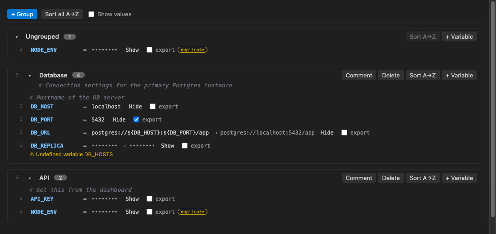

# Dotenv Manager

A visual editor for `.env` files in VS Code. Organize variables into commented groups, reorder them with drag and drop, sort each group A→Z and see what `${VAR}` references resolve to, while the file on disk stays a plain `.env` file.



## Features

- **Groups and comments.** Put variables in named groups, and add a comment above any variable or on a group.
- **Drag and drop.** Reorder variables within a group, move them to another group, or reorder whole groups. The file is rewritten in the new order.
- **Keyboard moves.** <kbd>Alt</kbd>+<kbd>↑</kbd> / <kbd>Alt</kbd>+<kbd>↓</kbd> move the focused variable or group.
- **Sort A→Z per group.** Sort one group from its card, or every group with **Sort all A→Z** (also in the Command Palette). Group order is never changed, and comments move with their variable.
- **`${VAR}` references** ([dotenv-expand](https://github.com/motdotla/dotenv-expand) syntax):
  - `${VAR}`, `$VAR`, `${VAR:-default}` and `${VAR-default}` show their resolved value next to the raw value.
  - Typing `${` in a value suggests existing variable names.
  - Undefined references and reference cycles appear as warnings in the editor and in the **Problems** panel.
  - Renaming a variable offers to update every reference to it.
- **Find every .env file.**
  - The status bar shows **Dotenv Manager (n)**, with n the number of listed `.env` files in the workspace. Click it for a searchable list of them, with variable counts.
  - A **Dotenv Files** panel in the Explorer always lists them.
  - Both search all workspace folders at any depth and update as files are created, deleted or renamed. `node_modules`, `.git`, `dist`, `out`, `build`, `.next`, `coverage` and `vendor` are skipped by default; change that with `dotenvManager.exclude`.
- **Create .env files.** Use the selector, the panel, or right-click a folder in the Explorer. Paths like `apps/api/.env.local` work, the name must be one from `dotenvManager.envFiles`, and existing files are never overwritten.
- **Commented-out variables.** Lines like `# API_KEY=old-value` are recognised as variables that are switched off. Tick **Show commented (n)** in the toolbar to see them (greyed out, marked *commented*), and use **Comment out** / **Uncomment** on any row to switch a variable off or on. dotenv ignores them, so they never count as definitions, duplicates or reference targets.
- **Text preview.** Tick **Preview** next to **Sort all A→Z** to split the editor: the GUI stays on the left and the file's text appears on the right, highlighted and updated with every change. It is read-only and hides values unless **Show values** is ticked; use **Open as text** to edit the text directly.
- **Masked values.** Values are hidden until you click **Show** on a row or tick **Show values**.
- **Safe editing.** Every action is a normal edit to the text document, so undo/redo, save and the unsaved-changes marker work as usual. You can keep the text editor open beside the GUI; both stay in sync.
- **Lossless.** Lines you don't touch are written back exactly as they were: quotes, `export`, inline comments, multiline values, CRLF line endings and lines the parser doesn't understand.

## Usage

### Which files

Dotenv Manager only handles the file names listed in the **Dotenv Manager › Env Files** setting (`dotenvManager.envFiles`). The default list is:

```json
"dotenvManager.envFiles": [".env", ".env.local", ".env.development", ".env.production", ".env.test", ".env.example"]
```

Add or remove names to change what is detected and counted, e.g. `".env.staging"`. Entries are file names (no folders) and may use `*`, `?`, `{a,b}` and `[abc]`, e.g. `".env.*.local"`. Every other file, including look-alikes such as `.env.ts` or `.env.json`, is ignored.

### Opening files

`.env` files always open in the normal text editor. Dotenv Manager opens only when you ask for it:

- right-click it in the **Explorer** and choose **Open with Dotenv Manager**,
- click the **Open with Dotenv Manager** button (the **E** icon) in the editor title bar,
- run **Dotenv Manager: Open with Dotenv Manager** from the Command Palette, or
- right-click the editor tab and choose **Open with Dotenv Manager** (or **Reopen Editor With… → Dotenv Manager**).

To see the raw text, click **Open as text** in the Dotenv Manager toolbar or the **Open as Text** button in the editor title bar. The two views replace each other in the same tab. If the file has unsaved changes, both tabs stay open so nothing is lost.

### Finding .env files

- **Status bar:** **Dotenv Manager (n)** shows how many `.env` files the workspace has; hover it to see them. Clicking it (or running **Dotenv Manager: Select .env File**) opens a list grouped by workspace folder, showing each file's folder and variable count. Pick a file to open it as text, or use the buttons on an entry to open it in Dotenv Manager.
- **Explorer panel:** the **Dotenv Files** panel lists the same files. Click one to open it as text, or use the inline **Open with Dotenv Manager** button. The panel's title bar has the selector and a refresh button.
- **Create a file:** choose **Create .env file…** at the end of the selector, the **New File** button on the panel, the link in an empty panel, or **Create .env File…** when you right-click a folder in the Explorer. Enter a name or a path relative to the folder (default `.env`). Missing folders are created. An existing file is never overwritten; you're offered to open it instead.
- **Excludes:** `dotenvManager.exclude` lists glob patterns that aren't searched. It defaults to the folders above. A pattern without `/` matches that name at any depth; `**`, `*`, `?`, `{a,b}` and `[abc]` are supported. To stop skipping `vendor`, remove it from the list.
- Hide the status bar item with `dotenvManager.statusBar.enabled: false`.

If an earlier version made Dotenv Manager the default editor, those `workbench.editorAssociations` entries are removed the first time this version starts.

| Action | How |
|---|---|
| Edit a key, value or comment | Click it. <kbd>Enter</kbd> saves, <kbd>Shift</kbd>+<kbd>Enter</kbd> adds a line break, <kbd>Esc</kbd> cancels. |
| Add a variable | **+ Variable** on a group card |
| Add a group | **+ Group** in the toolbar |
| Move a variable or group | Drag the ⠿ handle, or <kbd>Alt</kbd>+<kbd>↑</kbd> / <kbd>Alt</kbd>+<kbd>↓</kbd> |
| Sort | **Sort A→Z** on a group, **Sort all A→Z** in the toolbar |
| Switch to another .env file | The **File** dropdown at the start of the toolbar lists every detected file as `<workspace folder>/<path>` (hover an entry for its full path). Picking one opens it in Dotenv Manager in a new tab. |
| Save the file | **Save** at the left of the toolbar (enabled when there are unsaved changes), or Ctrl/Cmd+S |
| See the file text beside the GUI | Tick **Preview** in the toolbar |
| Comment out / uncomment a variable | **Comment out** or **Uncomment** on the row. Tick **Show commented (n)** to see commented-out variables. |
| Delete a group | **Delete** on the group card. You can keep its variables; they move to the group above. |

## File format

Dotenv Manager reads structure from ordinary comments, so the file still works with every dotenv loader:

```dotenv
# === Database ===
# Connection settings for the primary Postgres instance

# Hostname of the DB server
DB_HOST=localhost
DB_PORT=5432
DB_URL=postgres://${DB_HOST}:${DB_PORT}/app
```

- **Group header:** a line of the form `# === Name ===`.
- **Group comment:** comment lines directly below the header, up to the first blank line.
- **Variable comment:** comment lines directly above a variable, with no blank line in between.
- **Ungrouped:** variables before the first header.
- **Free comments:** comment blocks followed by a blank line belong to no variable and are kept where they are.

When the GUI moves or sorts variables, it inserts a blank line where needed so a comment can't end up attached to the wrong variable or group.

## Settings

| Setting | Default | Description |
|---|---|---|
| `dotenvManager.envFiles` | `.env`, `.env.local`, `.env.development`, `.env.production`, `.env.test`, `.env.example` | File names Dotenv Manager detects and opens; nothing else is touched |
| `dotenvManager.exclude` | `node_modules`, `.git`, `dist`, `out`, `build`, `.next`, `coverage`, `vendor` (as `**/…`) | Glob patterns not searched for `.env` files |
| `dotenvManager.statusBar.enabled` | `true` | Show **Dotenv Manager (n)** in the status bar |

## Commands

| Command | Description |
|---|---|
| `Dotenv Manager: Open with Dotenv Manager` | Open the current `.env` file in the visual editor |
| `Dotenv Manager: Open as Text` | Show the current `.env` file in the text editor |
| `Dotenv Manager: Select .env File` | Pick one of the workspace's `.env` files to open |
| `Dotenv Manager: Create .env File…` | Create a new `.env` file in a workspace folder and open it |
| `Dotenv Manager: Refresh .env Files` | Search the workspace for `.env` files again |
| `Dotenv Manager: Sort All Groups A→Z` | Sort the variables of every group. Works from the text editor too. |

## Notes

- References resolve against the variables in the same file only, never your shell's environment, so the editor shows what the file itself defines.
- When a key is defined more than once, the last definition wins (as in dotenv), and both rows are marked **duplicate**.
- Editing a value re-formats that one line (for example `KEY = value` becomes `KEY=value`). Lines you don't edit are left as they are.

## Development

To install the extension from a local build (VS Code or Cursor) without the Marketplace, see [INSTALL.md](INSTALL.md).

```sh
npm install
npm run build            # bundle extension and webview into dist/
npm test                 # unit tests (Vitest)
npm run test:integration # integration tests in a downloaded VS Code
npm run lint
npm run package          # build a .vsix
npm run preview          # GUI in the browser at http://127.0.0.1:5178/
npm run install:cursor   # package and install into Cursor (install:code for VS Code)
```

- **In VS Code:** press <kbd>F5</kbd> (**Run Extension**) to start an Extension Development Host with the `test/fixtures` workspace. Keep `npm run watch` running and use **Developer: Reload Webviews** to pick up GUI changes, or **Developer: Open Webview Developer Tools** to inspect them.
- **In a browser:** `npm run preview` serves the GUI with a fake extension host (`preview/host.ts`) that runs the real parse → edit → serialize code against a sample file. The right pane shows the resulting `.env` text and is editable, and there are Undo/Redo, Reset and a light/dark theme toggle. Saving files under `src/` rebuilds and reloads the page. Set `PORT` to change the port.

## License

[MIT](LICENSE)
